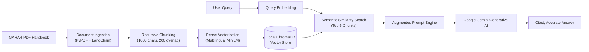

# GAHAR Healthcare Accreditation RAG Assistant

[](https://www.python.org/downloads/)
[](https://palletsprojects.com/p/flask/)
[](https://www.trychroma.com/)
[](https://ai.google.dev/)
[](https://huggingface.co/sentence-transformers)

A high-performance, domain-specific Retrieval-Augmented Generation (RAG) platform that enables hospital administrators, compliance officers, and clinical leadership to query official healthcare quality and safety accreditation standards interactively.

---

## 📋 Project Purpose & Clinical Context

Healthcare facilities seeking national accreditation under the **General Authority for Healthcare Accreditation and Regulation (GAHAR)** must comply with hundreds of rigorous clinical, operational, and architectural standards across dozens of chapters (Infection Control, Medication Management, Patient Safety, Governance, and Facility Management).

Navigating dense 400+ page regulatory handbooks manually causes compliance friction and audit delays. This system solves that problem by transforming the complete official **GAHAR Handbook for Hospitals Accreditation Standards** into an intelligent conversational knowledge engine.



---

## 🛠️ Architecture & Core Components

1. **Document Ingestion (`ingest.py`):**
   - Ingests the complete 7.9 MB official GAHAR accreditation manual.
   - Segments raw text using `RecursiveCharacterTextSplitter` (chunk size: 1000, chunk overlap: 200).
   - Generates multilingual dense embeddings using Hugging Face's `sentence-transformers/paraphrase-multilingual-MiniLM-L12-v2`.
   - Stores embeddings and metadata persistently in `./chroma_db`.

2. **Web Application & Retrieval Engine (`app.py`):**
   - Flask REST API exposing `/api/chat`.
   - Embeds incoming queries in real time.
   - Performs top-$k$ nearest neighbor search against ChromaDB to extract exact regulatory clauses.
   - Synthesizes grounded, hallucination-free explanations via Google Gemini (`gemini-1.5-flash`, `gemini-2.0-flash`).

3. **Frontend UI (`templates/chat.html`):**
   - Clean, accessible, modern chat interface designed for hospital staff.
   - Formats citations, chapter references, and checklist requirements clearly.

---

## 🚀 1-Click Scalable Startup (`start_app.bat`)

The project includes an automated, self-healing startup batch script for instant local execution on Windows:

```
Double-click: start_app.bat
```

### Script Execution Sequence:
1. **Python Detection:** Verifies Python runtime (prioritizing Python 3.11 for wheel compatibility).
2. **Environment Isolation:** Creates isolated virtual environment (`venv`) and upgrades pip.
3. **Dependency Sync:** Automatically installs required packages from `requirements.txt`.
4. **Security Guardrail:** Checks for `.env`. If absent, prompts the user to enter their `GEMINI_API_KEY` and writes it locally (never committed to git).
5. **Knowledge Base Ingestion:** Detects if the ChromaDB vector index exists; if not, triggers `ingest.py` to embed the accreditation handbook.
6. **Launch:** Automatically opens `http://127.0.0.1:5000` in your default web browser and starts the Flask server.

---

## 🔒 Security & Safe Secret Handling

- **No Committed Secrets:** API keys are never hardcoded. All credentials reside strictly in local `.env` files.
- **Git Protection:** `.env`, `.env.local`, Python virtual environments (`venv/`, `venv311/`), and vector store caches (`chroma_db/`) are strictly ignored via `.gitignore`.
- **Reference Configuration:** A sanitized template is provided in `.env.example`.

---

## 📦 Manual Installation (Optional)

If running in a custom Linux or macOS environment:

```bash
# 1. Clone repository
git clone https://github.com/Abdulrahman-MK/RAGv1.git
cd RAGv1

# 2. Create and activate virtual environment
python -m venv venv
source venv/bin/activate  # On Windows: venv\Scripts\activate

# 3. Install dependencies
pip install -r requirements.txt

# 4. Configure environment
cp .env.example .env
# Edit .env and set: GEMINI_API_KEY="your_api_key_here"

# 5. Ingest handbook into vector database
python ingest.py

# 6. Run web application
python app.py
```
Open [http://127.0.0.1:5000](http://127.0.0.1:5000) in your browser.
